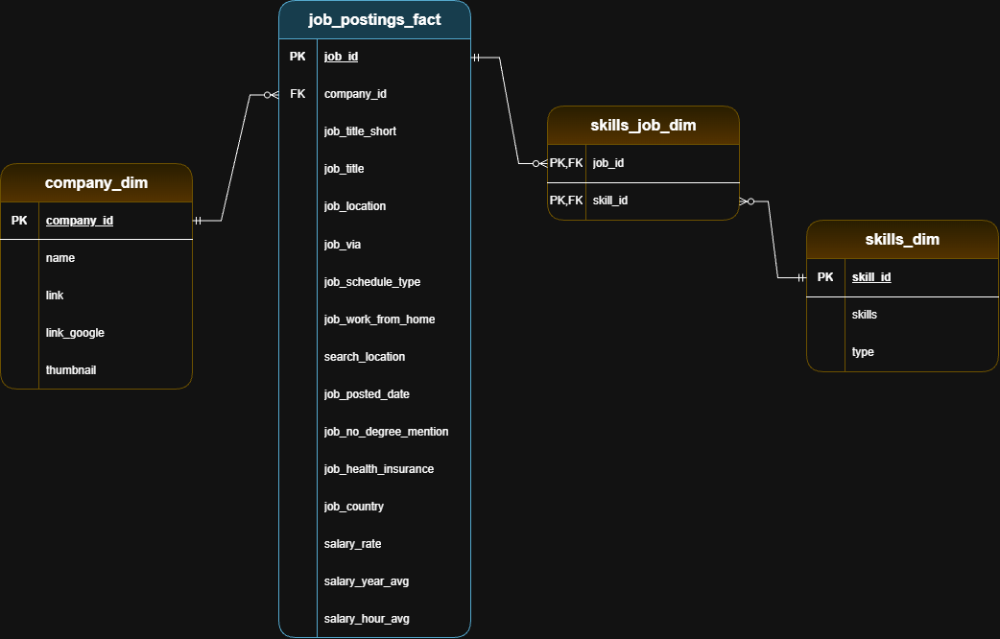

# Exploratory Data Analysis w/ SQL: Job Market Analysis

A SQL project analyzing the Data Engineer job market using real-world job posting data. It demonstrates my ability to **write analytical SQL queries, design efficient queries, and turn business questions into data-driven insights**.

## Executive Summary
- ✅ **Project scope:** Built **3 analytical queries** that answer key questions about the data engineer job market
- ✅ **Data modeling:** Used **multi-table joins** across fact, dimension and bridge tables to extract insights
- ✅ **Analytics:** Applied **aggregations, filtering and sorting** to find top skills by demand, salary and overall value
- ✅ **Key Findings:** Identified the most in-demand skills, highest-paying technologies, and skills offering a balance between demand and compensation.

If you only have a minute, check out these queries:
1. [`01_top_demanded_skills.sql`](../1_EDA/01_top_demanded_skills.sql) - Identifies the most frequently requested skills
2. [`02_top_paying_skills.sql`](../1_EDA/02_top_paying_skills.sql) - Identifies the highest-paying skills based on median annual salary
3. [`03_optimal_skills.sql`](../1_EDA/03_optimal_skills.sql) - Ranks skills by combining logarithmic demand and median salary

## Problem & Context

Job market analysts need to answer questions like:
- 🎯 **Most in-demand:** *Which skills are most in-demand for Data Engineers?*
- 💰 **Highest paid:** *Which skills are associated with the highest median annual salaries?*
- ⚖️ **Best trade-off:** *Which skills offer the best balance between market demand and salary potential?*

This project analyzes a **data warehouse** built using a star schema design. 

The warehouse structure consists of:
- **Fact Table:** `job_postings_fact` - Central table containing job posting details (job titles, locations, salaries, dates, ets.)
- **Dimension Tables:** 
    - `company_dim` - Company information linked to job postings
    - `skills_dim` - Skills catalog with skill names and types
- **Bridge Table:** `skills_job_dim` - Resolves the many-to-many relationship between job postings and skills

The queries join these tables to connect job postings with their associated skills and analyze market demand and salary trends.

## Tech Stack
- **Query Engine:** DuckDB for fast OLAP-style analytical queries
- **Language:** SQL (ANSI-style with analytical functions)
- **Data Model:** Star Schema with fact + dimension + bridge tables
- **Development:** VS Code for SQL editing + Terminal for DuckDB CLI
- **Version Control:** Git/GitHub for versioned SQL scripts

## Analysis Overview

### Query Structure
1. [**Top Demanded Skills**](../1_EDA/01_top_demanded_skills.sql) - Identifies the 10 most in-demand skills for remote Data Engineer positions
2. [**Top Paying Skills**](../1_EDA/02_top_paying_skills.sql) - Analyzes the 25 highest-paying skills with salary and demand metrics
3. [**Optimal Skills**](../1_EDA/03_optimal_skills.sql) - Calculates a custom optimal_score that combines logarithmic demand and median annual salary to identify the most valuable skills to learn:

`optimal_score = (LN(demand_count) * median_salary) / 1_000_000`

#### Why Use LN()?
Applying the natural logarithm reduces the influence of very high demand counts. Without this transformation, highly demanded skills such as Python and SQL would dominate the ranking due to their significantly larger demand counts.

This approach balances demand and salary, allowing specialized skills with higher salary potential to remain competitive in the ranking.

### Key Insights
- 🧠 Core languages: SQL and Python each appear in ~29,000 job postings, making them the most in-demand skills
- ☁️ Cloud platforms: AWS and Azure are critical for modern data engineering roles
- 🧱 Infra & tooling: Kubernetes, Docker and Terraform are associated with premium salaries
- 🔥 Big data tools: Apache Spark show strong demand with competitive compensation

## SQL Skills Demonstrated
### Query Design & Optimization
- **Complex Joins:** Multi-table `INNER JOIN` operations across `job_postings_fact`, `skills_job_dim` and `skills_dim`
- **Aggregations:** `COUNT()`. `MEDIAN()`, `ROUND()` for statistical analysis
- **Filtering:** Boolean logic with `WHERE` clauses and multiple conditions (`job_title_short`, `job_work_from_home`, `salary_year_avg IS NOT NULL`)
- **Sorting & Limiting:** `ORDER BY` with `DESC` and `LIMIT` for top-N analysis

### Data Analysis Techniques
- **Grouping:** `GROUP BY` for categorical analysis by skill
- **Conditional Logic:** `CASE WHEN` statements for derived metrics
- **Mathematical Funcitons:** `LN()` for natural logarithm transformation to normalize demand metrics
- **Calculated Metrics:** Derived optimal score combining log-transformed demand with median salary
- **HAVING clause:** Filtering aggregated results  (skills with >= postings)
- **NULL handling:** Proper filtering of incomplete records (`salary_year_avg IS NOT NULL`)